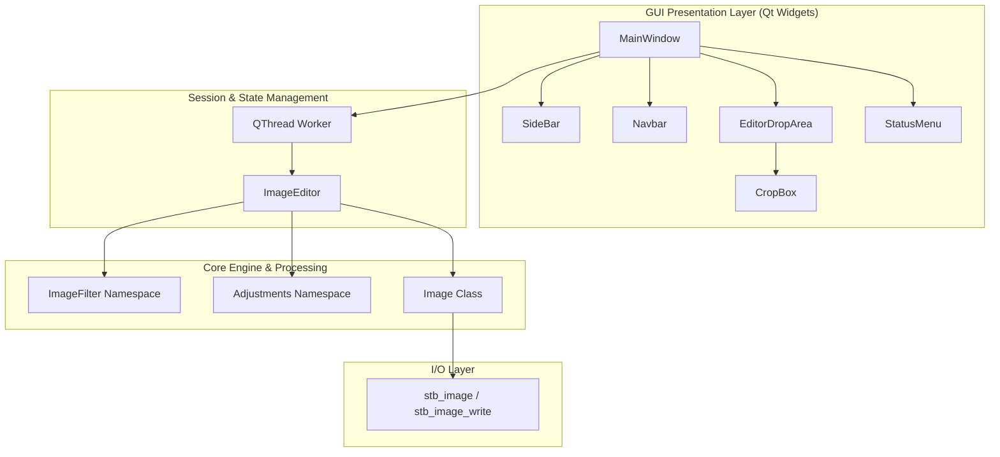

# 🎨 ATripleM

<p align="center">
  <strong>A modern, lightweight, and high-performance desktop image editor and processing suite built with C++17 and Qt.</strong>
</p>

<p align="center">
  
  
  
  
  
</p>

---

## 📖 Table of Contents

- [Overview](#-overview)
- [Key Features](#-key-features)
- [Filter & Tool Catalog](#-filter--tool-catalog)
  - [Color & Tonality Adjustments](#1-color--tonality-adjustments)
  - [Artistic & Stylistic Filters](#2-artistic--stylistic-filters)
  - [Spatial & Geometric Transformations](#3-spatial--geometric-transformations)
  - [Frames & Borders](#4-frames--borders)
  - [Multi-Image Blending & Merging](#5-multi-image-blending--merging)
- [Technical Architecture](#-technical-architecture)
- [Mathematical & Algorithmic Highlights](#-mathematical--algorithmic-highlights)
- [Project Directory Structure](#-project-directory-structure)
- [Prerequisites](#-prerequisites)
- [Build and Installation](#-build-and-installation)
  - [Option A: Build with Qt Creator (Recommended)](#option-a-build-with-qt-creator-recommended)
  - [Option B: Build via CMake Command Line](#option-b-build-via-cmake-command-line)
- [How to Use](#-how-to-use)
- [Supported Image Formats](#-supported-image-formats)
- [Contributors & Credits](#-contributors--credits)

---

## 🌟 Overview

**ATripleM** is an open-source, feature-packed desktop image processing application. Developed using **modern C++ (C++17)** and the **Qt Framework (Qt 6 / Qt 5 Widgets)**, it provides users with an intuitive, responsive graphical interface alongside a robust set of pixel-manipulation algorithms.

Under the hood, ATripleM relies on lightweight, header-only image loaders ([`stb_image`](lib/include/stb_image.h) & [`stb_image_write`](lib/include/stb_image_write.h)) eliminating bulky external dependencies. All image processing operations are executed on background threads (`QThread`) to ensure the user interface remains smooth, fluid, and responsive at all times.

---

## ✨ Key Features

- **⚡ Asynchronous Multithreaded Processing**: Heavy computational tasks run off the UI thread via `QThread`, accompanied by an animated busy indicator and real-time status feedback.
- **🔄 Infinite History (Undo / Redo / Reset)**: Non-destructive workflow powered by a dual-stack history engine (`std::deque` & `std::stack`), letting you easily step backwards or forwards through your edit history or reset directly back to the original image.
- **👁️ Live Non-Destructive Previews**: Sliders for brightness, contrast, saturation, and skew provide real-time interactive previews calculated against base states, with explicit **Apply** or **Cancel** options.
- **🖱️ Drag-and-Drop Image Loading**: Open images by selecting them through the file browser or by simply dragging and dropping them into the canvas workspace.
- **✂️ Interactive On-Canvas Crop**: Drag and resize an interactive bounding box directly over the previewed image to visually frame your cut before applying.
- **🎨 Custom Styling & Theming**: Polished dark-mode UI with vector SVG icons, collapsible scrollable tool sidebars, and customizable framing colors using native color pickers.
- **🛡️ Unsaved Changes Warning**: Confirmation prompts safeguard against accidental data loss when closing images or quitting the application.

---

## 🧰 Filter & Tool Catalog

### 1. Color & Tonality Adjustments
- **Brightness Adjustment**: Scale pixel brightness linearly in the range `[-100, 100]` with live preview.
- **Contrast Enhancement**: Contrast adjustment using non-linear midpoint scaling around gray level 128 in range `[-100, 100]`.
- **Saturation Adjustment**: Boost or desaturate image vibrance by interpolating channel distance relative to grayscale intensity.

### 2. Artistic & Stylistic Filters
- **Grayscale Conversion**: Converts RGB channels to uniform luminance using average intensity mapping.
- **Black & White (Binarization)**: High-contrast threshold binarization partitioning pixels into pure black (`0`) or pure white (`255`).
- **Invert Colors (Negative)**: Bitwise inversion producing negative photographic results ($255 - \text{pixel}$).
- **Darken & Lighten**: Quick tone-shifting shortcuts.
- **Box Blur**: Multi-pass $5 \times 5$ spatial neighborhood averaging filter for smooth blurring.
- **Edge Detection (Sobel Filter)**: Gradient operator calculating magnitude via $G_x$ and $G_y$ convolution kernels to outline sharp edges.
- **Sunlight Effect**: Warm ambient filter boosting red/green channels while dampening blues for a natural golden-hour look.
- **Infrared Filter**: Simulated thermal look setting maximum red intensity while inverting blue and green channels.
- **Purple / Cyberpunk Effect**: Artistic tint emphasizing cyan and magenta tones.
- **Old TV Simulation**: Retro cathode-ray tube (CRT) scanline effect with horizontal scanline interleaving.
- **Oil Painting Filter**: Texture filter grouping local neighborhood pixels into intensity bins and rendering the dominant intensity mode.

### 3. Spatial & Geometric Transformations
- **Rotation**: Lossless $90^\circ$, $180^\circ$, and $270^\circ$ clockwise rotations with automatic aspect ratio handling.
- **Flipping**: Horizontal reflection (mirror) and vertical flip across image centerlines.
- **Image Resizing**: Arbitrary width and height scaling using nearest-neighbor interpolation.
- **Interactive Cropping**: Freeform visual crop box with coordinate validation preventing out-of-bounds selection.
- **Skew / Shear**: Horizontal axis shear mapping with real-time slider control spanning from $-45^\circ$ to $+45^\circ$.

### 4. Frames & Borders
- **Simple Border**: Solid frame of configurable pixel thickness and custom color selected via `QColorDialog`.
- **Fancy Border**: Multi-layered ornamental border with concentric decorative framing lines in contrasting colors.

### 5. Multi-Image Blending & Merging
- **Merge by Scaling**: Scales a secondary overlay image to match the canvas dimensions and applies uniform alpha blending ($0\% - 100\%$).
- **Merge by Common Area**: Positions an overlay image onto the canvas at a user-defined $(X, Y)$ offset with adjustable alpha transparency.

---

## 🏛️ Technical Architecture

ATripleM is structured with a clean separation of concerns:



- **`GUI/`**: Manages user interface components, signal-slot connections, events, and asynchronous UI dispatching.
- **`include/ImageEditor.h` & `src/ImageEditor.cpp`**: Controls the editor session, state stacks (`changes`, `changesUndone`), non-destructive preview buffers (`adjustBase`), and lifecycle operations.
- **`include/ImageFilter.h` & `src/ImageFilter.cpp`**: Pure C++ algorithmic implementations of image processing operations and filters.
- **`include/Image.h`**: In-memory representation of pixel buffers (width, height, channels) with raw byte access and memory management.
- **`lib/include/`**: Header-only implementations of `stb_image.h` and `stb_image_write.h`.

---

## 📁 Project Directory Structure

```plaintext
ATripleM/
├── GUI/                         # Qt User Interface
│   ├── icons/                   # Vector SVG icons
│   ├── CMakeLists.txt           # Build instructions for GUI executable
│   ├── CropBox.h                # Interactive crop selection overlay
│   ├── EditorDropArea.h/.cpp    # Canvas display & drag-and-drop handler
│   ├── main.cpp                 # Application entry point
│   ├── MainWindow.h/.cpp/.ui    # Main application window & event wiring
│   ├── navbar.h/.cpp            # Top navigation bar & menus
│   ├── resources.qrc            # Qt resource file for icons
│   ├── SideBar.h/.cpp/.ui       # Tool palettes, sliders, and controls
│   └── StatusMenu.h/.cpp        # Bottom status bar & async progress indicator
├── include/                     # Core engine header files
│   ├── Image.h                  # Image buffer representation & I/O wrapper
│   ├── ImageEditor.h            # History, session manager, and API
│   └── ImageFilter.h            # Filter prototypes and color definitions
├── src/                         # Core algorithmic implementations
│   ├── ImageEditor.cpp          # Editor state logic implementation
│   └── ImageFilter.cpp          # Filter algorithms & math implementation
├── lib/                         # External third-party libraries
│   └── include/
│       ├── stb_image.h          # Header-only image reader
│       └── stb_image_write.h    # Header-only image writer
├── .gitignore                   # Git ignore configuration
└── README.md                    # Project documentation
```

---

## 💻 Prerequisites

Ensure you have the following installed on your system:

| Dependency | Minimum Version | Notes |
| :--- | :--- | :--- |
| **C++ Compiler** | C++17 | GCC / MinGW 11+, Clang 13+, or MSVC 2019+ |
| **Qt Framework** | Qt 6.x or Qt 5.15+ | `Qt::Widgets` module required |
| **CMake** | 3.16 or higher | Build configuration tool |
| **Make / Ninja** | Any modern version | Build automation tool |

---

## 🔨 Build and Installation

### Option A: Build with Qt Creator (Recommended)

1. Open **Qt Creator**.
2. Select **File > Open File or Project...**
3. Navigate to `D:/projects/QT/GUI/CMakeLists.txt` and open it.
4. Select your preferred Qt Kit (e.g., **Desktop Qt 6.x MinGW 64-bit** or **MSVC 64-bit**).
5. Click **Configure Project**.
6. Press `Ctrl + R` (or click the green **Run** button) to build and launch the application.

---

### Option B: Build via CMake Command Line

Open your preferred terminal (PowerShell, Command Prompt, or Bash) and execute:

```bash
# 1. Clone or navigate to the repository directory
cd D:/projects/QT

# 2. Create a build directory
mkdir build
cd build

# 3. Configure the project with CMake (pointing to the GUI directory)
cmake ../GUI -DCMAKE_BUILD_TYPE=Release

# 4. Compile the project
cmake --build . --config Release

# 5. Run the application
# On Windows:
./GUI.exe
# On Linux / macOS:
./GUI
```

> [!TIP]
> If CMake cannot locate your Qt installation automatically, pass the `CMAKE_PREFIX_PATH`:
> ```bash
> cmake ../GUI -DCMAKE_PREFIX_PATH="C:/Qt/6.x.x/mingw_64"
> ```

---

## 🚀 How to Use

1. **Open an Image**:
   - Click **File > Open** in the top navigation bar, or
   - Drag and drop any supported image file directly onto the canvas area.
2. **Apply Filters & Adjustments**:
   - Choose a tool category from the left sidebar (**Filters**, **Adjust**, **Rotate**, **Flip**, **Add Frame**, **Resize**, **Crop**, **Skew**, or **Merge**).
   - For slider-based tools (**Adjustments**, **Skew**, **Merge**):
     - Drag the sliders to see a **real-time live preview**.
     - Click **Apply** to commit your change, or **Cancel** to revert back to your previous state.
3. **Crop an Image**:
   - Click **Crop** in the sidebar.
   - Adjust the bounding box on the image canvas.
   - Click **Apply** to execute the crop.
4. **Undo / Redo / Reset**:
   - Use **Edit > Undo** (`Ctrl+Z`) or **Edit > Redo** (`Ctrl+Y`) to step back and forth.
   - Click **Edit > Reset** to restore the image back to its original loaded condition.
5. **Save Your Work**:
   - Click **File > Save** to overwrite the active file.
   - Click **File > Save As** to save your edited image under a new name or format.

---

## 🖼️ Supported Image Formats

Thanks to integration with `stb_image` and `stb_image_write`, ATripleM supports loading and exporting the following standard image formats:

- **PNG** (`.png`)
- **JPEG / JPG** (`.jpg`, `.jpeg`)
- **Bitmap** (`.bmp`)
- **Truevision TGA** (`.tga`)

*(All loaded files are normalized to standard 24-bit 3-channel RGB for uniform processing).*

---

## 👥 Contributors & Credits

Developed with ❤️ by:
- **Moustafa Mahmoud** 
- **Moataz** 
- **Abdullah** 
- **Mohamed Sherif**

Special thanks to:
- **FCAI - Cairo University** (Faculty of Computers and Artificial Intelligence)
- Dr. Mohamed El-Ramely and the original course teaching team for foundational class definitions.
- Sean Barrett and contributors for the [`stb`](https://github.com/nothings/stb) single-file public domain libraries.

---

<p align="center">
  <sub>ATripleM • Engineered with C++ & Qt</sub>
</p>
